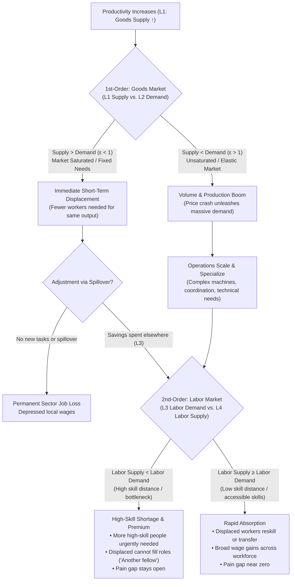

# The Technology Trap: Acemoglu & Restrepo + Bessen, with Time Lags

Evidence: Carl Benedikt Frey, *The Technology Trap* (2019), chapter tags (Intro, Ch. 1–13).
Frameworks:

- **Acemoglu & Restrepo (A&R):** "The Race between Man and Machine" (*AER* 2018) and "Automation and New Tasks" (*JEP* 2019). Frey builds on their framework (Intro; Ch. 9).
- **Bessen:** "Automation and Jobs: When Technology Boosts Employment" (*Economic Policy* 2019).
- **Adão, Beraja & Pandalai-Nayar:** "Fast and Slow Technological Transitions" (*JPE Macroeconomics* 2024). Used for evidence on L3 and L4.

Companion files: `technology-trap-numbers.md`, `technology-trap-sync-forces.md`, `technology-trap-perpetual-displacement.md`, `power-and-progress-redirecting-technology.md`.

> **Source labels.** 📘 = number from Frey's book. 📗 = number from the framework papers, outside the book (verify against the originals before publishing). 🧮 = my calculation or inference from 📘 numbers.

---

## 1. The model

### 1a. Acemoglu & Restrepo: three forces on labor demand

```
Δ Labor demand  =  − Displacement      machines take over tasks workers did
                   + Productivity      cheaper output → more demand → more labor in tasks not automated
                   + Reinstatement     NEW tasks in which labor has the advantage
```

- **Displacement** always reduces labor's share of tasks.
- **Productivity** can offset it, but only if the technology is productive enough. "So-so technologies" displace workers without much productivity gain, so they're the worst case.
- **Reinstatement** is the only force that restores labor's share. In Frey's words: "the creation of new tasks is essential to raise the demand for labor, workers' wages, and the share of national income going to labor." 📘 (Intro)

### 1b. Bessen: when demand catches up (the inside of the productivity effect)

For a single industry, employment = output ÷ output per worker. If productivity rises by *g* and prices fall by about the same amount:

```
% Δ jobs in the industry  ≈  (ε − 1) × g        ε = price elasticity of demand
```

| Demand regime | ε | Effect of automation on the industry's jobs |
| --- | --- | --- |
| **Unsaturated**: a new product, a large unmet market | ε > 1 | Jobs **rise**. Demand catches up and overtakes productivity. |
| **Saturated**: a mature product, needs already met | ε < 1 | Jobs **fall**. Demand cannot catch up. |

Over a product's life, ε falls as the market saturates, so industry employment traces an **inverted U**: it rises for decades during automation, then falls. 📗 Bessen shows this for US cotton textiles, steel, and motor vehicles.

#### When demand plateaus: structural barriers to catch-up

Can demand hit a ceiling where it never increases and plateaus ($\varepsilon \to 0$)? Yes. In these scenarios, lower prices generate little to no additional volume, making own-industry L2 catch-up impossible:

1. **Biological / physical limits (Engel's Law):** Calorie intake has a biological ceiling. Mechanization collapsed grain prices, but per-capita consumption remained flat. Agricultural employment in the US collapsed from ~40% (1900) to <2% today. 📘
2. **Discrete utility / functional saturation:** Many durable goods satisfy a binary household need (e.g. one refrigerator per kitchen, one water heater per home). Once near-universal penetration is reached, demand drops to replacement rate; cheaper units do not induce households to buy multiples.
3. **Finite task bounds:** Certain tasks have rigid structural limits (e.g. lighting a street corner at dusk, routing a telephone call). Once electrified lighting or automatic telephone switching decoupled output from human hours, demand for the specific task hit a hard ceiling and human employment collapsed to near-zero. 📘

**Consequences when demand plateaus:**
- **Own-industry recovery fails:** The industry is locked into the downward slope of the inverted U; every subsequent productivity gain ($\Delta g$) directly destroys net industry headcount.
- **Adjustment relies 100% on spillover demand:** Any recovery must come from consumers spending their price savings on *other* products or sectors.
- **Pain gap expands with skill distance:** Because displaced workers must transition to different industries, the duration of the pain gap is dictated by whether the new external jobs match their existing skills (farming $\to$ factory labor) or require unreachable new human capital (typesetters / factory workers $\to$ software engineers).


### 1c. Combined

```
Δ Jobs = − Displacement
         + Own-industry demand  (ε − 1)·g      ← Bessen
         + Spillover demand     (savings spent elsewhere)
         + Reinstatement        (new tasks)     ← A&R
```

### 1d. The blind spot both models share: *whose* jobs

Both models count jobs and wages **in aggregate**. Frey's central point is that reinstatement often goes to "**another fellow**" (children in the 1800s, the highly skilled after 1980). 📘 So two balances are tracked:

- **Aggregate balance:** do the new jobs outnumber the lost ones?
- **Displaced-group balance:** do the *same* people get comparable jobs?

Resistance follows the **second** balance, not the first.

---

## 2. The time-lag layer

The lags are a **sequential chain** viewed from the general population. When a firm adopts a technology, that matters only to the firm. What the population feels starts when productivity rises and current needs can be met with fewer people.

```
                    L1                      L2                         L3                          L4
Productivity ↑ ─────────────▶ Needs catch up ─────────────▶ Needs outpace ─────────────▶ New jobs ─────────────▶ Right people
(current needs met            (prices fall, market          productivity               exist at scale         fill them
 with fewer people             grows: Bessen ε)              → labor demand rises        (A&R reinstatement)    (displaced, or
 → DISPLACEMENT)                                                                                                 "another fellow")
│◀──────────────────────────────────────── PAIN GAP for the displaced group ───────────────────────────────────────────▶│
```

| Lag | From → to | What happens to people | Evidence of its length |
| --- | --- | --- | --- |
| **L1 Productivity ramp** | Productivity gains begin → fully realized | Current needs are met with fewer workers, so **displacement builds up** over this period. A fast ramp means a sudden shock. A slow ramp spreads displacement out. | 📘 Electricity: ~40 years (1882 → 1920s, after factories were reorganized). 📘 Steam: "very slight as late as 1830," with gains 1850–70. 📘 Tractors: 3.6% of farms (1920) → 80% (1960). 📘 Computers: Solow's 1987 paradox → 1996–99 boom. 📘 Water frame: spinning labor costs −2/3, with displacement "almost immediate." |
| **L2 Needs catch-up** | Displacement → demand grows enough to **outpace** productivity | Cheaper goods expand the market. If ε > 1, needs overtake productivity and labor demand recovers in that industry. If ε < 1, needs **never** catch up there, and recovery has to come from needs in *other* industries (spillover). | 📘 Model T: $950 → $263 (1908–27); households with a car 2.3% → 89.8% (1910–30), **~20 years**. 📘 Refrigerators: $568 → $137 in **3 years**. 📘 Containers: trade +320% in **5 years**. 📘 Steel: needs outpaced productivity throughout 1890–1929, so L2 ≈ 0. |
| **L3 New jobs** | Needs outpace productivity → new jobs exist at scale | Extra demand turns into jobs: more of the same jobs (Bessen) or **new kinds of work** (A&R reinstatement). | 📘 Auto jobs grew 765% faster than manufacturing in the industry's first 30 years. 📘 Power-loom weaving: "a new labor market had to develop," which took **decades**. 📘 About half of 1980–2008 job growth came from new types of work. 📗 ICT job demand surged in **1980–90** (Adão, Beraja & Pandalai-Nayar 2024). |
| **L4 Skill match** | New jobs exist → people with the right skills fill them | Displaced workers retrain or move, **or** the jobs go to "another fellow" (a new generation, or a different skill group). | 📘 Garment cutters: 5.6 months on average, but **90% of those over 45 never** recovered their pay. 📘 Pennsylvania workers displaced in the early 1980s: −25% earnings **6 years** later. 📘 High school diplomas 9% → 40% (1910–35), a **generation**. 📗 ICT workers only arrived **after 2000**, almost all of them young (Adão et al.). |

**Key rule:** displacement starts as soon as productivity rises. Every recovery step (L2 → L3 → L4) comes **after** it, in sequence. So a pain gap always opens, and its length is roughly **the sum of the lags still unfinished for the displaced group**.

**Shortcuts in the chain** 🧮
- **ε > 1 from the start** (steel, cars): needs outpace productivity right away, so L2 ≈ 0 and the gap barely opens.
- **ε < 1** (food, mature manufacturing, typesetting): needs never catch up *within* the industry. L2 is satisfied only through needs in **other** industries, and L3/L4 then need workers to move across industries.
- **L4 is the only lag measured per person.** L2 and L3 can be complete for the economy while L4 is never complete for older displaced workers, who wait for generational replacement.
- **A slow L1** (tractors over 40 years) spreads displacement out, so L2–L4 can keep pace. A fast L1 into a saturated market is the worst case.

### 2a. Two-tier supply-demand tree (1st-order goods vs. 2nd-order labor)

The four lags operate as two coupled supply-demand markets in sequence:
- **1st-order (Goods & Services Market):** L1 (Goods supply capability) meets L2 (Goods demand / market elasticity $\varepsilon$).
- **2nd-order (Labor & Skills Market):** L3 (Labor demand for new tasks) meets L4 (Labor supply / worker capabilities).



```text
Productivity Increases (L1: Output Supply Capacity ↑)
│
├── [1st-Order: Goods Market] Output Supply > Consumer Demand (ε < 1, Saturated)
│   └── Result: Immediate Short-Term Displacement
│       └── Current needs met with fewer workers.
│           ├── If no spillover / no new tasks: Permanent job loss in sector.
│           └── If consumer savings create new tasks elsewhere: Moves to 2nd-Order Labor Market (below).
│
└── [1st-Order: Goods Market] Consumer Demand > Output Supply (ε > 1, Unsaturated)
    └── Result: Volume Boom & Structural Specialization
        └── Lower prices trigger explosive market expansion (cars, steel, early ICT).
        └── Operations become complex, requiring advanced coordination and maintenance.
        │
        └── [2nd-Order: Labor Market] L3 (Labor Demand for New Tasks) vs. L4 (Labor Supply)
            ├── Labor Supply < Labor Demand (High Skill Distance):
            │   ├── More high-skill people urgently needed (wage premium rises).
            │   ├── Displaced low/mid-skill workers cannot fill them ("another fellow").
            │   └── Pain gap stays wide.
            │
            └── Labor Supply ≈ Labor Demand (Low Skill Distance):
                ├── Displaced workers transition smoothly (farmhand → assembly worker).
                └── Pain gap near zero; broad-based wage growth.
```

### 2b. The lag chain by era

| Era / case | L1 Productivity ramp | L2 Needs catch-up | L3 New jobs | L4 Skill match | Pain gap 📘 |
| --- | --- | --- | --- | --- | --- |
| **Textiles, 1st Industrial Revolution** | Fast for spinning (water frame). Slow for steam (1784 → 1830s–70) | Fast: cotton went from marginal to 8% of GDP (1750–1830). ε > 1 | Factory jobs existed early, but **for children**. Jobs suited to adults came only with larger steam machines (1830s+) | Decades: power-loom weavers' wages "took decades" to rise | **~70 yrs** |
| **Steel, 1890–1929** | ~40 yrs | ≈ 0 (ε > 1 throughout) | Same jobs, growing | Same skills | **~0** |
| **Cars, 1908–30** | — (new product) | ~20 yrs of market expansion | Massive (+765% vs. manufacturing) | Semiskilled, similar to existing skills | **Net gain** |
| **Farms, 1920–60** | **Slow: ~40 yrs** | Never within farming (food ε < 1). Met through needs in other industries (cars, manufacturing) at the same time | Already growing in cities: 79% of the decline in hand cotton-picking was due to the pull of higher wages | Short: semiskilled to semiskilled. Long for older workers | **Short** |
| **Computers and robots, 1980–** | Gains delayed (1987 paradox → 1990s) | Never within mature manufacturing (ε < 1). Needs moved into low-pay services | ICT jobs surged in 1980–90 📗, but **high-skill** | **Never for older workers. ~40 yrs for the young** 📗 | **40+ yrs, open** |
| **AI** | Slow so far (Amara's Law, 12% of use cases deployed) | ❓ New products (ε > 1) or cheaper old services (ε < 1)? | ❓ "Will spawn new tasks," likely high-skill | ❓ Depends on skill distance 📗 | ❓ |

---

## 3. Applying the model to each era

### 3a. First Industrial Revolution: textiles (Britain, ~1770–1840)

| Term | Reading | Evidence |
| --- | --- | --- |
| **Displacement** | 🔴 Very high | 📘 Water frame cut spinning labor costs by 2/3. Hand-loom weavers' incomes fell "almost immediately." |
| **Demand (Bessen ε)** | 🟢 ε > 1 at the industry level | 📘 Cotton went from a marginal industry (1750) to 8% of GDP (1830). Cheap cloth found mass and export markets. 🧮 Total textile employment grew: factories filled up. |
| **Reinstatement** | 🟡 Yes, but the wrong group | 📘 New factory tasks were "designed to be tended by children"; children were ~50% of the textile workforce by the 1830s. |
| **Aggregate balance** | Positive | Jobs existed. |
| **Displaced-group balance** | 🔴 **Negative for decades** | 📘 Adult artisans lost: weaver unemployment 60–69%. 📘 Output per worker +46% vs. wages +12% (1780–1840). |
| **Lags** | L1 steam: ~50 years (1784 → 1830s–70). L3/L4: adult skills regained value only once larger steam machines needed skilled operators. | 📘 Ch. 4, 5, 8 |
| **Pain gap** | **~70 years** (1770s → 1840s) | 📘 "Some seven decades." |

**Reading:** Bessen's condition held (ε > 1, the industry grew), so the **aggregate looked fine**. The pain came from A&R's reinstatement going to the wrong group. **Demand catch-up isn't enough if the new tasks don't fit the displaced workers.**

### 3b. Second Industrial Revolution: three sub-cases (US, ~1870–1970)

| Case | Displacement | Bessen ε | Reinstatement | Lags | Pain gap |
| --- | --- | --- | --- | --- | --- |
| **Steel 1890–1929** | Labor per ton −68% 📘 | 🧮 **ε > 1**: output per worker rose ~3.1×, yet employment grew, so output grew more than 3.1× | Not needed: demand absorbed it | L2 short | **~0**. "Probably little job displacement" 📘 |
| **Cars 1908–1930** | Low (new product) | 🧮 **ε ≫ 1**: price as a share of income fell 316% → 43%, households with a car 2.3% → 89.8% 📘 | 🟢 Massive: auto jobs grew 765% faster than manufacturing 📘 | L2 ~20 yrs | **Negative**: net job *creation* |
| **Agriculture 1920–1960** | 🔴 High: −5.7M farm jobs, 3.4B man-hours saved 📘 | 🧮 **ε < 1**: food demand is inelastic (📗 Engel's law), so productivity cut farm jobs | 🟢 In **other** industries, for the **same class** of semiskilled workers: 79% of the decline in hand cotton-picking was due to higher wages elsewhere 📘 | **L1 long**: tractors 3.6% → 80% over 40 years, so displacement was spread out | **Short** for most workers. Long for older workers. |
| **Electricity (factories)** | Low: enabling | — | Productivity effect dominant | L1 ~40 yrs 📘 | **~0**: wages rose throughout |
| **Lamplighters 1907–27** | 🔴 Total for that task | ε > 1 for *light* (cost −90% 📘), but the task disappeared | Other jobs available in a booming economy | L1 ~20 yrs phase-out | Short for most |

**Era aggregate:** 📘 wages rose at all levels, and the top-decile share fell ~10 points (1913–48). 📗 A&R estimate that in **1947–87** displacement (about −0.5%/yr) and reinstatement (about +0.5%/yr) **roughly balanced**.

**Reading:** where ε < 1 (farming), displacement was large, but **reinstatement elsewhere matched the same workers' skills**, and a **slow productivity ramp** (long L1) gave time to adjust. Where ε > 1 (cars, steel), demand caught up and jobs grew. Both offsetting channels worked, so the pain gap stayed near zero. The exception was **1927–41**, when demand collapsed in the Depression (L2 reversed) and the "machinery question" returned. 📘 (Ch. 7)

### 3c. Computer and robot age (US, ~1980–2019)

| Term | Reading | Evidence |
| --- | --- | --- |
| **Displacement** | 🔴 High, focused on routine middle-skill tasks | 📘 −3.3 jobs per robot. −7M+ manufacturing jobs since 1979. Typesetters −56%. |
| **Demand (Bessen ε)** | 🔴 **ε < 1** in mature manufacturing and clerical work | 🧮 Mature, saturated products: productivity now cuts industry jobs (the downward side of Bessen's inverted U). 📘 Typesetters: printed text demand didn't expand enough. |
| **Spillover demand** | 🟡 Into low-pay services | 📘 Affluent "symbolic analysts" spent more on personal services, so workers moved into janitorial and child-care jobs. 📘 Nontradable services were 98% of job growth 1990–2008. |
| **Reinstatement** | 🟡 Yes, but for the **highly skilled** | 📘 Software engineers, database administrators: "an economy designed by geniuses to be operated by other geniuses." |
| **A&R aggregate** | 🔴 Displacement > reinstatement | 📗 **1987–2017:** displacement accelerated (about −0.7%/yr) while reinstatement slowed (about +0.35%/yr). 📘 Labor share 64% → 58%. |
| **Displaced-group balance** | 🔴 Negative | 📘 Non-college men's real wages falling since the 1980s. Janesville: $28 → $15–16/hr. |
| **Lags** | L1: J-curve, with gains only in the 1990s. L2: never within mature manufacturing. L3: ICT jobs fast but high-skill. L4: "costlier than ever"; MDTA retraining showed unclear benefits. | 📘 Ch. 9, 12, 13 |
| **Pain gap** | **40+ years, still open in 2019** | 📘 Productivity 8× faster than pay since 1979. |

**Reading:** this is the worst combination. **Displacement is high, ε < 1** (demand can't catch up in the mature sectors), **reinstatement favors other skills**, and **L4 is long** because the skill distance is large. All three offsetting channels failed for the displaced group at the same time.

### 3d. AI (future): open variables

| Term | Frey's reading | What decides it |
| --- | --- | --- |
| Displacement | 🔴 "Predominantly replacing": 47% of jobs automatable, 83% of workers earning under $20/hr at high risk 📘 Speed of the productivity ramp (L1) |
| Demand ε | ❓ Services such as transport, retail, and call centers: mostly mature (🧮 likely ε < 1), with some new markets (diagnostics, translation) where ε may be > 1 | Whether AI makes **new products** or cheaper old ones |
| Reinstatement | ❓ "Will spawn new tasks," but probably for the highly skilled 📘 | Direction of innovation (A&R: firms can choose labor-augmenting designs) |
| L1 | Slow so far: Amara's Law. $80B invested in autonomous driving with few deployments. 12% of use cases deployed commercially 📘 | Regulation, cost, worker opposition |
| L4 | Costly: "the cost of acquiring new human capital… has become much greater" 📘 | Ch. 13 policy: early education, wage insurance, relocation |
| **Feedback** | "If Amara's Law ceases to hold, it will likely be due to the return of Luddite sentiment." 📘 A long pain gap → resistance → slower productivity ramp (L1) | Politics |

---

## 4. Summary scorecard

| Era / case | Displacement | L1 ramp | L2 Bessen ε | L3 new jobs → same workers? | L4 skill match | Pain gap | Outcome 📘 |
| --- | --- | --- | --- | --- | --- | --- | --- |
| Textiles, 1st Industrial Revolution | 🔴 High | Fast (spinning) | 🟢 > 1 | 🔴 No (children) | Decades | **~70 yrs** | Luddites, Swing riots |
| Steel, 1890–1929 | 🟡 Medium | Moderate | 🟢 > 1 | n/a (same jobs grew) | — | ~0 | Jobs grew |
| Cars, 1908–30 | 🟢 Low | — | 🟢 ≫ 1 | 🟢 Yes | Short | Net gain | Mass middle class |
| Farms, 1920–60 | 🔴 High | **Slow (40 yrs)** | 🔴 < 1 (needs met elsewhere) | 🟢 Yes (city jobs) | Short (except older workers) | Short | Accepted |
| Computers and robots, 1980– | 🔴 High | Delayed, then fast | 🔴 < 1 | 🔴 No (highly skilled) | Never (older) / ~40 yrs (young) | **40+ yrs, open** | Populist voting |
| AI | 🔴 High (projected) | Slow so far | ❓ | ❓ | ❓ | ❓ | Depends on policy |

### Rules the scorecard suggests 🧮

1. **ε > 1 protects the industry's jobs, not the displaced workers.** Textiles had demand catch-up and still produced a 70-year gap.
2. **ε < 1 can still be survivable if the new jobs fit the same workers** and the productivity ramp is slow (farming).
3. **The worst case is ε < 1 combined with new jobs for other skills and a fast productivity ramp.** That describes post-1980 automation, and possibly AI.
4. **Needs catch up fairly fast (L2: 3–20 years); new jobs and skill match (L3, L4) are slow (decades to a generation).** So whether the new jobs fit the displaced workers matters more than how fast needs catch up.
5. **Only reinstatement restores labor's share** (A&R). Demand catch-up alone raises output and jobs but can still leave labor's share falling, as in 1780–1840 (+46% output vs. +12% wages).

---

## 5. What the book can't measure *(limitations)*

- **No elasticity estimates in Frey.** Every ε reading above is 🧮 inferred from output and employment changes. Bessen's paper has the actual estimates.
- **No direct count of displaced vs. reinstated tasks before 1947.** The A&R decomposition (📗) starts in 1947. Earlier eras are qualitative.
- **Lag lengths are reconstructed from scattered dates**, not measured consistently. L3 and L4 especially are partly inferred.
- **Spillover demand is barely quantified in the book.** 📗 Autor & Salomons (2018) and Gregory, Salomons & Zierahn (2022) are the sources to add if you need it.
