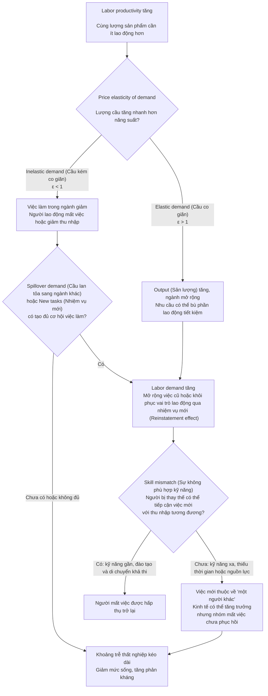
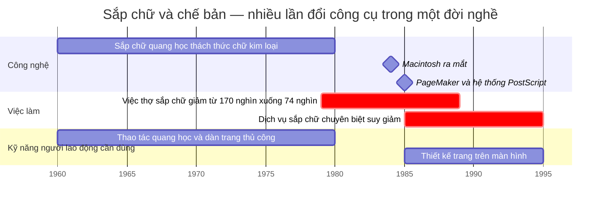
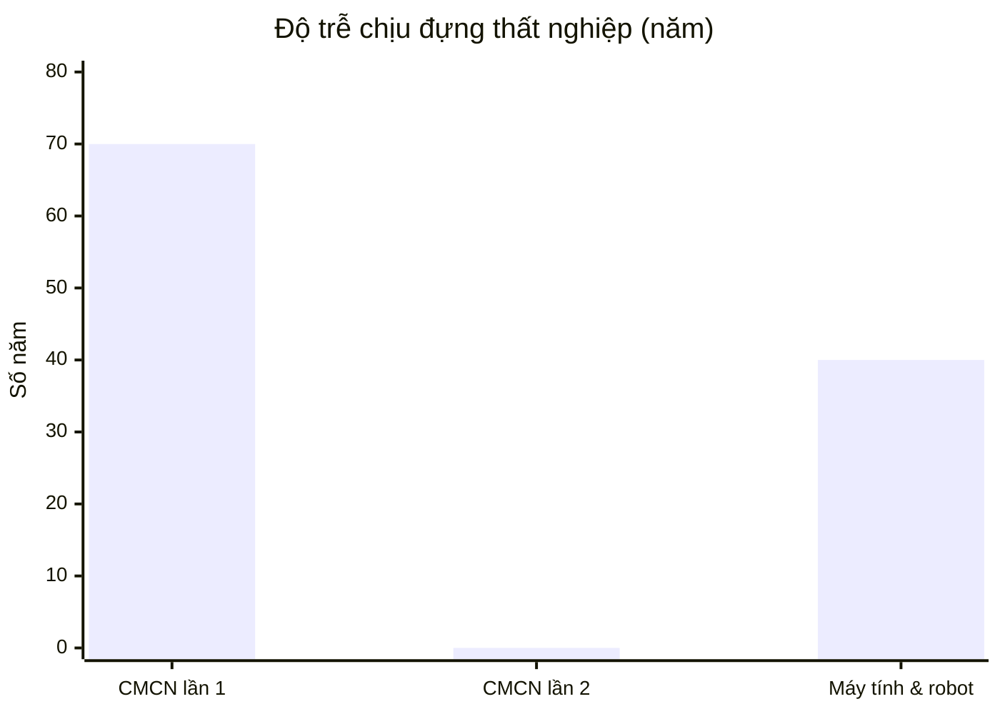

# Kỹ năng mới cập nhật, đã lỗi thời

*Vòng lặp thay thế kỹ năng, và vì sao người lao động luôn đến muộn một nhịp*

Phân tích từ hai sách:

- Carl Benedikt Frey, *The Technology Trap: Capital, Labor, and Power in the Age of Automation* (Princeton University Press, 2019).
- Daron Acemoglu & Simon Johnson, *Power and Progress* (PublicAffairs, 2023).

## 1. Mở đầu: những việc làm không quay trở lại

Máy kéo, máy gặt và các thiết bị khác đã khiến nhiều công việc thủ công trong nông nghiệp không còn cần số người như trước. Những việc làm ấy tiếp tục mất đi ngay cả khi kinh tế phục hồi. Nông nghiệp vẫn tồn tại với nhu cầu lao động thấp hơn trước.

Ở Mỹ, nông nghiệp sử dụng **45,9% lao động năm 1870**, nhưng đến năm 2015 chỉ còn **1%**. Đến năm 1960, số việc làm nông nghiệp đã giảm ròng **5,7 triệu** so với mức đỉnh. Riêng máy kéo tiết kiệm khoảng **3,4 tỷ giờ lao động** trong các công việc đồng áng và chăm sóc gia súc kéo, tương đương **1,74 triệu lao động**.

Người lao động phải tìm việc ở nơi khác để phục hồi thu nhập. Trong trường hợp nghề hái bông bằng tay, một nghiên cứu được Frey dẫn lại cho thấy **79% sự sụt giảm** đến từ tiền lương tăng nhanh hơn ở các công việc khác. Tiền lương tốt hơn ở nhà máy và thành phố đã thu hút nhiều người rời đồng ruộng.

Việc làm ở thành phố đủ hấp dẫn và đủ gần với kỹ năng sẵn có để nhiều lao động nông nghiệp chuyển sang. Họ có cuộc sống tốt hơn sau khi rời đồng ruộng. Một số người vẫn gặp khó khăn và không chuyển được.

Vấn đề hôm nay là liệu con đường ấy còn đủ dài để đi hết hay không. Một người vừa học kỹ năng cho công việc mới có thể gặp đợt tự động hóa tiếp theo trước khi kịp thuần thục. Tầng công cụ của nhiều nghề thay đổi theo năm, thậm chí theo tháng; còn học nghề, tích lũy kinh nghiệm và tìm được việc có thu nhập tương đương thường mất lâu hơn. Khi việc cũ không quay lại và việc mới liên tục đổi yêu cầu, người lao động phải đuổi theo một đích đến đang di chuyển.

Người mất việc cần bao lâu để học nghề mới và khôi phục mức sống? Nếu kỹ năng mới lại bị thay thế trước khi họ học xong thì sao?

## 2. Hai chiếc đồng hồ: tốc độ kỹ năng thay đổi và tốc độ con người học

### 2a. Kỹ năng thay đổi nhanh đến đâu?

Các nghiên cứu ghi nhận những thay đổi sau:

| Số liệu | Ý nghĩa |
| --- | --- |
| **47%** với nghề máy tính và toán học, so với **dưới 20%** với giáo dục, luật, công tác xã hội | Nghề càng gần công nghệ, vòng lặp càng nhanh. |
| **16%** tin tuyển dụng ngành máy tính năm 2007 đòi một kỹ năng đã lỗi thời vào năm 2019 (ví dụ: QuarkXPress, Adobe Flash, ActionScript, Solaris) | Một số kỹ năng cũ mất nhu cầu khi các kỹ năng mới xuất hiện. |
| **39%** kỹ năng cốt lõi của người lao động được giới chủ dự kiến sẽ thay đổi trong giai đoạn 2025–2030 (WEF, *Future of Jobs Report 2025*; con số này là 44% ở báo cáo 2023) | Gần 2/5 bộ kỹ năng thay đổi trong 5 năm, tức chưa đến một phần sáu của một đời nghề 30 năm. |

Cần phân biệt hai lớp kỹ năng:

- **Lớp thuần thục công cụ:** sử dụng phần mềm, framework, phiên bản mô hình AI và các thao tác cụ thể trong công việc. Công cụ có thể cập nhật theo tháng hoặc theo năm, buộc người lao động học lại cách sử dụng và quy trình thao tác. Việc đổi phiên bản chưa đủ để kết luận toàn bộ kỹ năng của người dùng đã lỗi thời.
- **Lớp nhận thức lõi:** hiểu nguyên lý, kiến thức lĩnh vực, cách xác định vấn đề, lập luận và phán đoán. Lớp này cần thời gian tích lũy và giúp người lao động chuyển kiến thức giữa các công cụ. Nó thường bền hơn kỹ năng thao tác; dữ liệu tuyển dụng và dự báo ở trên chưa đo riêng tốc độ lỗi thời của lớp nhận thức lõi.

Các nghiên cứu trên đo sự thay đổi yêu cầu kỹ năng ở cấp công việc trong khoảng 5–12 năm, với thước đo khác nhau; chúng chưa chứng minh toàn bộ kỹ năng nghề nghiệp mất giá sau một năm. Người lao động có nguy cơ phải dành nhiều thời gian cập nhật công cụ, làm giảm thời gian thực hành sâu để tích lũy nhận thức lõi.

### 2b. Con người học nhanh đến đâu?

| Số liệu | Ý nghĩa |
| --- | --- |
| Khoảng **10 năm** luyện tập có chủ đích để đạt trình độ chuyên gia (Ericsson, Krampe & Tesch-Römer, 1993) | Đạt trình độ thuần thục đòi hỏi nhiều năm luyện tập. |
| Chương trình đào tạo lại MDTA (1963–71) có gần **2 triệu** người tham gia, nhưng nhà kinh tế Ashenfelter kết luận *"khó thấy lợi ích có xứng với chi phí hay không"* | Đào tạo lại quy mô lớn không chắc hiệu quả. |
| Khi công nghệ thông tin bùng nổ, nhu cầu tuyển dụng tăng mạnh trong **1980–90**, nhưng nguồn cung lao động chỉ đáp ứng **sau năm 2000**, và gần như **toàn bộ là người trẻ**; người lao động lớn tuổi hầu như không chuyển sang được (Adão, Beraja & Pandalai-Nayar, *JPE Macro* 2024) | Khi kỹ năng mới xa kỹ năng cũ, quá trình thích nghi chủ yếu diễn ra qua thay thế thế hệ; đào tạo lại người lao động lớn tuổi đóng góp hạn chế. |

### 2c. Khi tốc độ đòi hỏi kỹ năng mới, nhanh hơn khả năng học

Deming & Noray đo được hậu quả trực tiếp của sự lệch nhịp này:

- Người học ngành có tốc độ thay đổi kỹ năng cao (chênh một độ lệch chuẩn, cỡ khoảng cách giữa Kỹ thuật và Lịch sử) được trả **cao hơn 50% ở tuổi 24**, nhưng chỉ **25% ở tuổi 34** và **16% ở tuổi 50**.
- Lợi thế thu nhập của ngành khoa học máy tính và kỹ thuật **giảm hơn một nửa trong thập kỷ đầu đi làm**.
- Người có năng lực cao có xu hướng rời khỏi các nghề thay đổi nhanh: ở tuổi 23 họ có khả năng làm nghề STEM cao hơn 5 điểm phần trăm, nhưng đến tuổi 40 thì không còn khác biệt.

Lý do, theo mô hình của họ: trong nghề thay đổi chậm, kinh nghiệm cộng dồn; trong nghề thay đổi nhanh, mỗi lần kỹ năng cũ bị thay, người lao động trở lại vạch xuất phát ở kỹ năng mới, nên kinh nghiệm không kịp tích lũy. Kỹ năng mới cập nhật đã bắt đầu mất giá.

## 3. Độ trễ giữa cải tiến và nhu cầu nhân lực

Để hiểu hơn độ trễ giữa sự cải tiến và khi nào nhu cầu nhân lực tăng lại, bài này dùng các ý tưởng từ hai mô hình sau đây:

### Acemoglu & Restrepo: Task-based framework

Biểu thức tóm tắt ba cơ chế:

$$
\Delta\,\text{Labor demand}
= -\text{Displacement effect}
+\text{Productivity effect}
+\text{Reinstatement effect}
$$

Trong đó **Δ Labor demand (thay đổi cầu lao động)** được diễn giải theo ba hiệu ứng dưới đây. Biểu thức này tóm tắt cơ chế; phương trình định lượng nguyên bản của tác giả cần được đối chiếu trong nghiên cứu gốc.

Ba cơ chế tác động lên **Labor demand (cầu lao động)**:

- **Displacement effect (hiệu ứng thay thế)**
  - Tự động hóa chuyển nhiệm vụ từ lao động sang vốn.
  - Máy móc đảm nhiệm những việc trước đây con người làm.
- **Productivity effect (hiệu ứng năng suất)**
  - Chi phí sản xuất giảm, sản lượng mở rộng.
  - Cầu lao động tăng ở các nhiệm vụ chưa bị tự động hóa.
- **Reinstatement effect (hiệu ứng khôi phục vai trò của lao động)**
  - Xuất hiện nhiệm vụ mới mà lao động có lợi thế so sánh.
  - Con người có thêm vai trò trong quá trình sản xuất.

### Bessen: Price elasticity of demand (độ co giãn của cầu theo giá)

Quan hệ cơ bản:

$$
\text{Employment}
= \frac{\text{Output}}{\text{Labor productivity}}
$$

- **Employment (việc làm)**
- **Output (sản lượng)**
- **Labor productivity (năng suất lao động)**

Việc làm tăng hay giảm phụ thuộc vào tốc độ tăng của sản lượng so với năng suất:

- **Elastic demand (cầu co giãn, ε > 1)**
  - Giá giảm khiến lượng cầu tăng mạnh.
  - Sản lượng tăng nhanh hơn năng suất → **việc làm tăng**.
- **Inelastic demand (cầu kém co giãn, ε < 1)**
  - Giá giảm nhưng lượng cầu tăng không đủ.
  - Sản lượng tăng chậm hơn năng suất → **việc làm giảm**.
- **Demand saturation (sự bão hòa của nhu cầu)**
  - Khi nhu cầu đã được đáp ứng phần lớn, giá giảm ít kích thích mua thêm.
  - Cầu có thể trở nên kém co giãn hơn theo thời gian.

Nhìn từ góc độ người lao động, đây là cây quyết định gồm hai yếu tố cung-cầu: trước hết, nhu cầu hàng hóa có tăng nhanh hơn năng suất không; sau đó, các việc làm được tạo ra có phù hợp với người vừa mất việc không.

Ba quy tắc rút ra từ mô hình:

1. Năng suất tăng không tự động dẫn đến mất việc ròng. Nếu nhu cầu tăng đủ mạnh và việc mới phù hợp, lao động có thể được hấp thụ ngay. Khoảng trễ thất nghiệp mở ra khi các lực bù đắp không đủ hoặc không đến kịp với nhóm bị thay thế.
2. Cần theo dõi hai cán cân. Cán cân *tổng thể* (việc mới có nhiều hơn việc mất không?) và cán cân *của nhóm bị thay thế* (chính những người mất việc có tìm được việc tương đương không?). Frey chỉ ra rằng việc làm mới thường thuộc về *"một người khác"*, *"nhóm bị thay thế"* thường hay phản kháng hoặc mất ý nghĩa cuộc sống.
3. Độ trễ chuyển đổi kỹ năng cần được theo dõi ở từng con người. Nền kinh tế có thể đã mở rộng nhu cầu và tạo ra việc mới, trong khi người lao động lớn tuổi vẫn không thể chuyển sang những việc ấy.

Vòng lặp xuất hiện khi đợt công nghệ tiếp theo đến trước khi người lao động hoàn tất việc chuyển đổi kỹ năng của đợt trước.

Ngành sắp chữ và chế bản cho thấy nhiều lần chuyển đổi công cụ trong khoảng thời gian của một đời nghề. Từ thập niên 1960 đến giữa thập niên 1990, người làm nghề phải đối mặt với chuỗi **Hot-metal typesetting (sắp chữ bằng kim loại nóng) → Phototypesetting (sắp chữ quang học) → Desktop publishing (xuất bản trên máy tính để bàn)**.

Ba nhịp chuyển đổi diễn ra như sau:

- **Công nghệ:** dịch vụ sắp chữ kim loại bị sắp chữ quang học thách thức trong thập niên **1960–1970**. Macintosh xuất hiện năm **1984**; năm **1985**, PageMaker cùng hệ thống dùng PostScript cho phép dàn trang trên màn hình. Frank Romano, bài lịch sử ngành in năm 2011.
- **Việc làm:** từ **1979 đến 1989**, số thợ sắp chữ và thợ chế bản giảm từ **170 nghìn xuống 74 nghìn**, lương trung vị thực tế giảm **16%**. Frey, chương 9, dẫn James Bessen. Trong **1985–1995**, các dịch vụ sắp chữ chuyên biệt tiếp tục suy giảm khi nhà thiết kế tự dàn trang bằng máy tính. Romano. Hai khoảng này chồng lấn; không thể quy toàn bộ mức giảm 1979–1989 cho công nghệ ra mắt năm 1985.
- **Kỹ năng:** kinh nghiệm vận hành máy đúc chữ phải nhường chỗ cho thao tác quang học, cắt dán và chuẩn bị trang; sau đó là sử dụng phần mềm dàn trang và thiết kế trên màn hình. Người đã chuyển sang quy trình quang học lại gặp một đợt đổi công cụ khi Desktop publishing xuất hiện. Frey lưu ý rằng nghề thiết kế đồ họa đòi kỹ năng khác nghề sắp chữ và dữ liệu chưa cho biết có bao nhiêu thợ sắp chữ chuyển nghề thành công.

Trong khoảng 35 năm, công cụ và quy trình của ngành thay đổi qua nhiều đợt. Một người đang làm nghề từ thập niên 1960 có thể gặp cả quá trình chuyển sang sắp chữ quang học lẫn xuất bản trên máy tính trong cùng đời nghề. Mỗi lần chuyển đổi đặt ra yêu cầu kỹ năng mới, đồng thời thay đổi người đảm nhiệm công việc: việc dàn trang chuyển từ dịch vụ sắp chữ sang nhà thiết kế.

Ở các cuộc cách mạng trước, một đợt kéo dài vài thập kỷ, nên dù người cha bị bỏ lại, người con vẫn bước thẳng vào hệ thống mới. Khi chu kỳ ngắn hơn một đời nghề, cơ chế "thay thế thế hệ" ấy không còn đủ: chính người con cũng sẽ phải học lại vài lần.

## 4. So sánh độ trễ: từ lúc mất việc đến lúc được hưởng thành quả

### 4a. Bảng tổng hợp

| Thời kỳ | Người bị thay thế | Họ mất gì | Thành quả xã hội | Khi nào *chính họ* hưởng | Độ trễ | Hậu quả với toàn thể |
| --- | --- | --- | --- | --- | --- | --- |
| **Cách mạng công nghiệp lần 1**  Anh, ~1770–1840 | Thợ thủ công  Thợ dệt tay | Thất nghiệp thợ dệt Stockport **60%** (1816), Darwen **69%** một thập kỷ sau.  Lương thực tế tăng **12%** trong khi năng suất tăng **46%** (1780–1840).  Tuổi thọ ở Manchester, Glasgow **thấp hơn ~10 năm** mức trung bình | Vải rẻ đi gần như ngay.  Giới chủ có **tỷ suất lợi nhuận tăng gấp đôi** | Mức ăn bình quân chỉ tăng từ **thập niên 1840**.  Nhiều người không bao giờ hưởng; việc mới thuộc về **trẻ em** (~50% lao động dệt thập niên 1830) | **~70 năm**  "Khoảng dừng Engels" | Phong trào **Luddites** (1811–16): **12.000 quân** được điều động, **hơn 30 người bị treo cổ**.  Bạo loạn **Captain Swing** (1830): **252 án tử**.  Bạo loạn giúp phe cải cách thắng bầu cử 1831 → **Đạo luật Cải cách 1832** |
| **Cơ giới hóa nông nghiệp**  Mỹ, 1920–60 | Nông dân | **−5,7 triệu** việc làm nông nghiệp.  Ngựa và la giảm từ 25 triệu xuống 3 triệu | Thực phẩm rẻ.  Máy kéo tiết kiệm **>8% GNP** (1954) | Nhanh với đa số: **79%** sự sụt giảm của nghề hái bông bằng tay là do người lao động được **kéo** sang việc lương cao hơn ở thành phố | **Ngắn**  Trừ người lớn tuổi | Chấp nhận.  Không có phong trào đập máy |
| **Thập niên 1920**  Mỹ | Thợ cắt may Chicago | Thất nghiệp trung bình **5,6 tháng**.  **12,9%** vẫn không có việc sau một năm | — | Đa số tìm lại việc.  **90% người trên 45 tuổi** không tìm được việc hoặc phải nhận lương thấp hơn | **Vài tháng** với người trẻ.  **Cả phần đời còn lại** với người lớn tuổi | |
| **Máy tính, robot và toàn cầu hóa**  Mỹ, 1979–nay | Công nhân nhà máy  Nhân viên văn phòng  Thợ sắp chữ | **−7 triệu** việc làm sản xuất từ 1979.  Mỗi robot thay **3,3** việc làm.  Thợ sắp chữ từ 170 nghìn còn 74 nghìn (1979–89), lương **−16%**.  Cạnh tranh nhập khẩu từ Trung Quốc làm mất **2,0–2,4 triệu** việc làm (1999–2011) (Acemoglu, Autor, Dorn, Hanson & Price, 2016) | Người tiêu dùng có hàng rẻ.  Năng suất tăng **nhanh gấp 8 lần** lương theo giờ từ 1979 | Tỷ lệ thất nghiệp của nam giới không có bằng đại học tăng từ 6% -> 12%  Công nhân Pennsylvania bị sa thải đầu thập niên 1980: thu nhập **−40%** ngay lập tức, **vẫn −25%** sau 6 năm | **40+ năm, chưa đóng lại** | Tỷ lệ tử vong ngắn hạn của người bị sa thải tăng **50–100%**.  Tuổi thọ **−1,5 năm**.  Tăng tỷ lệ tội phạm, ly hôn. |

### 4b. Độ trễ phụ thuộc vào bản chất công nghệ

Số liệu cho thấy nỗi đau không ngắn dần qua các cuộc cách mạng:

> *Chi tiết theo từng thời kỳ:*
>
> - **CMCN lần 1:** ~70 năm ("Khoảng dừng Engels").
> - **CMCN lần 2:** ~0 năm (công nghệ hỗ trợ: lương tăng cùng năng suất).
> - **Máy tính & robot:** 40+ năm → vẫn đang mở (tính đến 2019).

Sự khác biệt giữa các thời kỳ phụ thuộc vào việc làm mới được tạo ra và khả năng chuyển đổi kỹ năng của người mất việc, bên cạnh tốc độ phát minh:

- **Cách mạng công nghiệp lần 1:** nhu cầu vải tăng vọt (ε > 1), ngành dệt có thêm việc. Nhưng việc mới được thiết kế cho trẻ em, nên nhiều người thợ trưởng thành không thể chuyển sang việc mới trong 70 năm. Khoảng trống chỉ đóng lại khi máy hơi nước lớn hơn cần thợ lành nghề trưởng thành: từ 1840 đến 1900, lương thực tế tăng **123%**, nhanh hơn năng suất (**90%**).
- **Cách mạng công nghiệp lần 2:** việc mới (công nhân vận hành máy, nhân viên văn phòng) cần kỹ năng gần với kỹ năng cũ, và giáo dục chạy trước nhu cầu: cung kỹ năng tăng nhanh hơn cầu khoảng 1%/năm giai đoạn 1915–60. Thời gian chuyển đổi kỹ năng ngắn, nên khoảng trống gần như bằng không.
- **Thời đại máy tính:** sản phẩm công nghiệp đã bão hòa (ε < 1, nhu cầu trong ngành không tăng đủ để bù việc mất), việc mới thuộc về người có kỹ năng cao (*"một nền kinh tế được thiết kế bởi thiên tài để thiên tài khác vận hành"*), và khoảng cách kỹ năng lớn khiến quá trình điều chỉnh kéo dài cả một thế hệ.

### 4c. Ai thực sự hưởng thành quả của tiến bộ công nghệ, và khi nào?

Có ba nhóm hưởng thành quả theo ba nhịp khác nhau:

1. **Chủ sở hữu vốn:** hưởng ngay khi năng suất tăng (lợi nhuận gấp đôi thời Luddites; tỷ trọng thu nhập của lao động Mỹ giảm từ 64% xuống khoảng 58%).
2. **Người tiêu dùng:** hưởng sau vài năm, khi giá giảm (Model T từ 950 đô la xuống 263 đô la; giá chiếu sáng −90%). Nhưng Frey nhấn mạnh: lợi ích tiêu dùng chỉ đến sau khi việc thay thế đã xảy ra, và với người mất việc, nó không bù nổi phần thu nhập bị mất.
3. **Người bị thay thế:** bị sa thải ngắn hạn ngay lập tức, có thể mất cả đời người để được hưởng. Thường là con cái họ mới được hưởng.

Như Frey viết: *"Điều hiếm khi được nhắc tới là ngắn hạn có thể kéo dài cả một đời người."*

## 5. Hậu quả với toàn thể xã hội

Khoảng trễ thất nghiệp kéo dài gây thiệt hại cho người mất việc, gia đình họ và cộng đồng nơi họ sống. Chi phí lan rộng ra toàn xã hội.

**5a. Phản kháng chính trị.** Mỗi khi khoảng trống dài hơn một thế hệ, phản kháng bùng lên. Hình thức thay đổi theo quyền lực mà người bị thay thế nắm trong tay: không có phiếu bầu thì đập máy (Luddites); có công đoàn và phiếu bầu thì thương lượng (thế kỷ 20); công đoàn suy yếu nhưng còn phiếu bầu thì bỏ phiếu cho phe dân túy (2016).

**5b. Phản kháng làm chậm chính công nghệ.** Frey cảnh báo: *"Nếu định luật Amara ngừng đúng, rất có thể là do tâm lý Luddite quay trở lại."* Trong lịch sử, giới cầm quyền đã nhiều lần cấm máy móc vì sợ bất ổn: Nữ hoàng Elizabeth I từ chối cấp bằng sáng chế máy dệt kim (1589), nhiều thành phố châu Âu cấm máy dệt tự động (thế kỷ 17), Trung Quốc kháng cự công nghệ đến cuối thế kỷ 19. Khoảng trống càng dài, nguy cơ xã hội tự khóa tiến bộ càng lớn.

**5c. Xói mòn cộng đồng.** Tác hại tập trung theo địa phương: tỷ lệ đàn ông trung niên không đi làm là **51%** ở Flint (Michigan) nhưng chỉ **5%** ở Alexandria (Virginia). Ở khu dân cư lao động "Fishtown", tỷ lệ hộ có người làm toàn thời gian giảm từ **81% xuống 53%**.

**5d. Thui chột động lực học kỹ năng chuyên biệt.** Đây là hệ quả riêng của vòng lặp nhanh. Nếu một kỹ năng mất giá một nửa trong mười năm (Deming & Noray), người lao động có lý do chính đáng để không đầu tư sâu vào nó, và người giỏi nhất rời đi. Doanh nghiệp vì thế càng thiếu người, càng có động lực tự động hóa. Vòng lặp tự tăng tốc.

## 6. Hướng đi: ứng phó với vòng lặp thay thế kỹ năng

Cộng đồng và cá nhân có thể làm gì để chuyển việc, học kỹ năng mới và giữ thu nhập trong thời gian chuyển đổi? Các hành động dưới đây được đề xuất từ mô hình và bằng chứng trong bài. Hiệu quả phụ thuộc vào ngành nghề, cơ hội việc làm và nguồn lực của từng người.

### 6a. Cá nhân

#### Thử nhu cầu trước khi đầu tư học dài hạn

Mô hình Bessen gợi ý tìm những nơi nhu cầu có thể mở rộng khi chi phí giảm. Với cá nhân, câu hỏi cụ thể là: ai cần kết quả công việc này, và họ có sẵn sàng trả tiền không?

- Trao đổi với người tuyển dụng hoặc khách hàng về một vấn đề cụ thể họ đang gặp.
- Làm một dự án nhỏ, có phạm vi và tiêu chí đánh giá rõ ràng. Nếu có thể, thử bằng một đơn hàng trả phí.
- Dùng phản hồi để quyết định kỹ năng nào cần học sâu. Theo dõi cả thu nhập thực nhận và thời gian bỏ ra.

Một vài đơn hàng giúp kiểm tra cơ hội ban đầu; cần theo dõi thêm độ ổn định của nhu cầu trước khi chuyển nghề hoàn toàn.

#### Chọn bước chuyển gần với kinh nghiệm sẵn có

Adão và cộng sự cho thấy quá trình điều chỉnh chậm hơn khi kỹ năng của công việc mới khác xa kỹ năng người lao động đang có. Có thể dùng kết quả này để lựa chọn bước chuyển:

- Liệt kê những gì mình đã tích lũy: hiểu biết lĩnh vực, quan hệ khách hàng, quy trình, khả năng xử lý sự cố và kỹ năng thao tác.
- Tìm các công việc có nhu cầu thực tế dùng được phần lớn kinh nghiệm ấy; xác định phần kỹ năng còn thiếu.
- Học phần thiếu qua một nhiệm vụ cụ thể và nhờ người trong nghề đánh giá kết quả.
- Sau mỗi dự án, kiểm tra khả năng làm việc, cơ hội kiếm thu nhập và chi phí học tiếp để điều chỉnh hướng đi.

Frey lưu ý: *"đào tạo lại sẽ không phải là câu trả lời cho tất cả mọi người."* Người chuyển nghề cần cân nhắc sức khỏe, trách nhiệm gia đình và khả năng duy trì thu nhập trong lúc học.

#### Duy trì thu nhập trong thời gian chuyển đổi

Mất thu nhập làm giảm thời gian và nguồn lực dành cho việc học. Một kế hoạch chuyển đổi cần tính cả chi phí sinh hoạt:

- Tính mức chi tiêu thiết yếu, ngân sách học và thời gian có thể dành mỗi tuần.
- Khi hoàn cảnh cho phép, giữ một nguồn thu trong lúc thử hướng mới.

#### Tách kỹ năng thành ba tầng tốc độ

Nếu vòng lặp không thể dừng, người lao động có thể chọn đầu tư vào tầng nào:

| Tầng | Ví dụ | Tốc độ lỗi thời | Cách đầu tư |
| --- | --- | --- | --- |
| **Công cụ** | Phần mềm, framework, phiên bản mô hình AI | Tháng → vài năm | Học khi cần, vừa đủ dùng. Đừng biến nó thành bản sắc nghề nghiệp. |
| **Phương pháp** | Cách thiết kế hệ thống, cách phân tích dữ liệu, quy trình nghề | Vài năm → một thập kỷ | Học có hệ thống; cập nhật định kỳ. |
| **Nền tảng** | Kiến thức sâu về một lĩnh vực, lập luận, giao tiếp, phán đoán, hiểu con người | Nhiều thập kỷ | Đầu tư dài hạn và liên tục; đây là phần tích lũy được qua các vòng lặp. |

Logic của bảng này lấy từ phát hiện của Deming & Noray: kinh nghiệm chỉ cộng dồn ở những kỹ năng không bị thay. Người lao động có thể dành phần lớn thời gian học cho các tầng chậm, còn kỹ năng công cụ được học vừa đủ cho công việc hiện tại và cập nhật khi cần.

### 6b. Cộng đồng

#### Chia sẻ công việc thực tế và tín hiệu tuyển dụng

- Nhóm nghề nghiệp có thể tổng hợp tin tuyển dụng, dự án có trả phí và những nhiệm vụ khách hàng đang cần. Ghi rõ kỹ năng được yêu cầu, mức trả và điều kiện làm việc để thành viên chọn hướng học.
- Người đã dùng công cụ mới chia sẻ một quy trình hoàn chỉnh: công việc nào được cải thiện, lỗi thường gặp, cách kiểm tra kết quả và phần vẫn cần kinh nghiệm nghề.
- Cộng đồng duy trì một kho hướng dẫn dùng chung, ghi ngày kiểm tra và phiên bản công cụ. Thành viên chia nhau cập nhật để giảm thời gian mỗi người phải tự tìm hiểu lại.

#### Giữ cơ hội thực hành cho người mới

**Reinstatement effect (hiệu ứng khôi phục vai trò của lao động)** đặt ra câu hỏi: người học sẽ đảm nhiệm nhiệm vụ nào sau khi học xong?

- Ghép người có kinh nghiệm với người đang chuyển nghề để cùng làm một nhiệm vụ thực tế, với phần trách nhiệm tăng dần.
- Khi dùng AI, yêu cầu người học giải thích quyết định, kiểm tra lỗi và sửa kết quả. Những bước này giúp họ tích lũy khả năng phán đoán.
- Trong nhóm dự án, giữ phần việc vừa sức cho người mới, trả công khi họ tạo ra giá trị và phản hồi cụ thể sau mỗi lần thực hành.
- Dùng sản phẩm đã hoàn thành, chất lượng xử lý và khả năng làm việc độc lập để đánh giá tiến bộ.

#### Hỗ trợ thành viên vượt qua thời gian chuyển đổi

- Giới thiệu việc ngắn hạn có trả công, chia sẻ thiết bị và giúp thành viên tiếp cận người tuyển dụng.
- Lập quỹ tương trợ tự nguyện trong khả năng của nhóm, với tiêu chí hỗ trợ và thu chi minh bạch.
- Người cùng nơi làm việc có thể đề xuất thời gian học được trả lương, hướng dẫn nội bộ và cơ hội chuyển vị trí khi quy trình đổi công cụ.

Những cách này giúp giảm một phần chi phí chuyển đổi. Cộng đồng và cá nhân vẫn có giới hạn khi nhu cầu tuyển dụng suy giảm trên diện rộng.

## 7. Kết luận

Câu chuyện về tiến bộ công nghệ thường được kể ở cấp độ tổng thể: về lâu dài, ai cũng giàu hơn. Điều đó đúng. Nhưng lịch sử Frey ghi lại cho thấy "về lâu dài" có thể là 70 năm, và những người trả giá thường không phải những người được hưởng.

Khi lớp ngoài của kỹ năng thay đổi nhanh hơn thời gian thuần thục, người lao động có nguy cơ rơi vào trạng thái chuyển đổi thường trực. Họ phải học lại trong lúc thu nhập vẫn chưa phục hồi. Lịch sử cho thấy, khi đủ nhiều người chịu tình trạng ấy đủ lâu, phản kháng có thể xuất hiện dưới hình thức đập máy như những người Luddites, hay bỏ phiếu như cử tri vùng Rust Belt.

Tốc độ học của con người có giới hạn. Cá nhân có thể chọn bước chuyển gần với kinh nghiệm sẵn có, kiểm tra nhu cầu trước khi học dài hạn và dành thời gian cho nhận thức lõi. Cộng đồng có thể chia sẻ tín hiệu tuyển dụng, tạo cơ hội thực hành có hướng dẫn và hỗ trợ nhau duy trì thu nhập.

Một nhóm nghề nghiệp có thể bắt đầu bằng việc nhỏ: chọn một nhu cầu khách hàng đã xác nhận, ghép người có kinh nghiệm với người đang học và cùng hoàn thành một dự án có trả công. Theo dõi xem người tham gia có làm được việc, kiếm được thu nhập và dùng lại được kỹ năng ấy trong dự án tiếp theo hay không.

## Trích dẫn

- Carl Benedikt Frey, *The Technology Trap: Capital, Labor, and Power in the Age of Automation* (Princeton University Press, 2019).
- Daron Acemoglu & Simon Johnson, *Power and Progress* (PublicAffairs, 2023).

- Acemoglu & Restrepo, "The Race between Man and Machine," *American Economic Review* (2018); "Automation and New Tasks," *Journal of Economic Perspectives* (2019).
- Bessen, "Automation and Jobs: When Technology Boosts Employment," *Economic Policy* (2019).
- Frank Romano, ["The day the typesetting industry died"](https://whattheythink.com/articles/55522-day-typesetting-industry-died/), *WhatTheyThink*, 16/12/2011. Nguồn lịch sử ngành về chuyển đổi từ sắp chữ kim loại sang quang học và xuất bản trên máy tính.
- Deming & Noray, "Earnings Dynamics, Changing Job Skills, and STEM Careers," *Quarterly Journal of Economics* 135(4) (2020).
- Adão, Beraja & Pandalai-Nayar, "Fast and Slow Technological Transitions," *Journal of Political Economy Macroeconomics* 2(2) (2024).
- Beraja & Zorzi, "Inefficient Automation," *Review of Economic Studies* 92(1) (2025).
- Acemoglu, Autor, Dorn, Hanson & Price, "Import Competition and the Great US Employment Sag of the 2000s," *Journal of Labor Economics* 34(S1) (2016).
- World Economic Forum, *The Future of Jobs Report 2025*.
- Ericsson, Krampe & Tesch-Römer, "The Role of Deliberate Practice in the Acquisition of Expert Performance," *Psychological Review* (1993). *(Chưa đối chiếu lại trong lần viết này.)*
